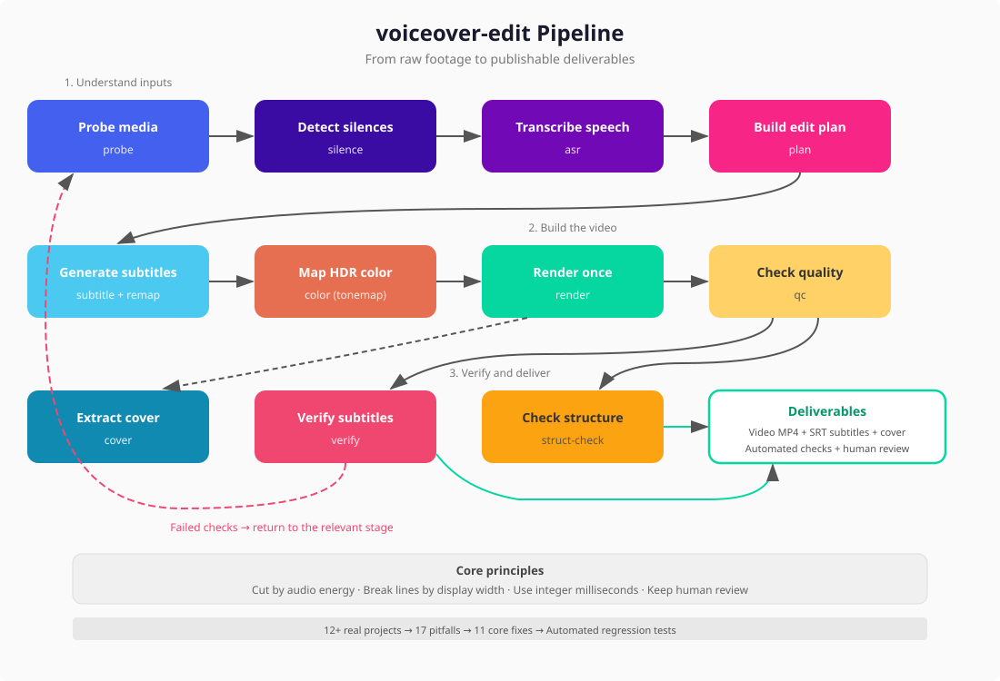

# voiceover-edit

**[中文](README.md) | English**

A talking-head video editing pipeline distilled from the rework logs of 12+ real production projects.

## Why this project exists

I was making vertical talking-head videos for Xiaohongshu: one person speaking to camera, with pauses removed, subtitles added, and a cover image delivered alongside the video.

The first 12 videos followed a semi-manual process: an AI agent drove ffmpeg and faster-whisper step by step. Each video typically needed two or three rounds of rework. The problem was not simply “bad code.” **The same kinds of failures kept returning on new videos**: subtitles drifted away from speech, footage looked washed out, 4K files would not open on an iPhone, and lines broke in odd places.

So I went back through the intermediate files, feedback, and rework history from all 12 projects. I traced each recurring failure to its root cause and turned the fixes into reusable code.

**This repository is the result of that retrospective.**

## The method: find failures, fix causes, iterate

### Step 1: Mine the rework history for root causes

The architecture did not come first. The failures did:

1. Review the session history and on-disk artifacts from 12 video projects.
2. Identify the immediate cause of every round of rework.
3. Rank issues by impact: visible output defects before workflow inefficiencies.
4. Map each cause to a specific pipeline stage: cutting, subtitles, rendering, color, and so on.

### Step 2: Fix each issue with a clear rationale

| Problem | Fix | Why |
|---|---|---|
| Washed-out video, with 42.91% overexposed pixels in one case | Raised the nominal peak luminance from 100 to 200 | Mapping iPhone HLG footage to SDR requires a higher reference value |
| Missing words in subtitles | Snapped words inside removed gaps to the nearest clip edge | Moving a word to the nearest valid position is better than dropping it |
| Invalid timestamp rollover such as `00:00:60` | Used integer milliseconds and `divmod` | Integer arithmetic avoids floating-point precision errors |
| Strange line breaks in mixed Chinese and English | Measured display width instead of character count | A Chinese character has width 1; a Latin character has width 0.5 |
| Product names split across lines | Added a protected-word list | Terms such as DeepSeek and GitHub must remain intact |
| Incompatible old and new data formats | Unified the schema and added automatic migration | Intermediate files from older runs remain readable |
| 4K output would not open on iPhone | Selected encoding parameters from the output resolution | H.264 profile and level requirements vary by resolution |
| Calls to functions that did not exist | Updated callers to use the real interfaces | Refactoring had changed interfaces without updating every caller |
| Structural checks compared a file with itself | Accepted two datasets and compared them | This exposes content lost during editing |
| ASR verification ignored parameter changes in its cache | Added model, prompt, and language to the cache key | A parameter change now invalidates stale results |
| Model paths pointed to deleted files | Updated four outdated references | Commands now point to a model directory that actually exists |

### Step 3: Prevent regressions with automated checks

Key fixes are covered by regression tests, including:

- SRT timestamp formatting, including rollover boundaries
- Display-width calculations for mixed Chinese and English
- Timeline remapping and gap snapping
- Compatibility with legacy edit-plan formats
- HDR color-parameter generation
- Import checks for all 14 modules
- Dispatch checks for all 9 CLI subcommands

## Three design decisions learned from failure

Each decision follows the same story: what we used to do, what went wrong, and what we do now.

### 1. Cut by audio energy, not ASR timestamps

**Before:** Cut points were calculated from faster-whisper word timestamps.

**What went wrong:** ASR timestamps can drift by 0.3–0.5 seconds on sentence-initial function words. A whole word could be cut from the audio while its text remained in the subtitles.

**Now:** RMS audio energy determines silence boundaries. ASR answers “what was said,” not “where should we cut.”

### 2. Break lines by display width, not character count

**Before:** `len()` determined where subtitle lines should break.

**What went wrong:** `len("to B")` is 4, but those four characters occupy only two Chinese-character widths. Short English fragments could end up alone on one line while the next line contained only a few characters.

**Now:** `display_width()` assigns 1.0 to fullwidth characters and 0.5 to halfwidth characters.

### 3. Use integer milliseconds for SRT timestamps

**Before:** Floating-point seconds were formatted as `HH:MM:SS,mmm`.

**What went wrong:** A value such as 59.9999… seconds could become the invalid timestamp `00:00:60,000`.

**Now:** Integer milliseconds are split with `divmod`, eliminating the precision problem.

## Workflow



The main stages can run independently or as a complete pipeline. Color conversion and timeline remapping happen inside the pipeline. Failed checks send work back to the relevant stage; a human still reviews the final video before publication.

Regenerate both diagrams with the Python standard library:

```bash
python docs/generate_workflow_diagram.py
```

## How the project evolved

| Stage | What changed | Evidence |
|---|---|---|
| v0: Scattered scripts | Each video project had its own scripts | The `scripts/` directories from 12 projects |
| v1: Pattern discovery | Recurring failures were identified across rework histories | Session records and user feedback |
| v2: Common components | Ten reusable implementations were compared across projects | Cross-checks of on-disk artifacts |
| v3: Unified package | The scripts became `voiceover_edit`, with a shared data schema | Code review and schema design |
| v4: Fixes and tests | Eleven core defects were fixed and regression checks were added | The problem-fix table above |
| v5: Documentation | Seventeen field-tested pitfalls were documented | Real production incidents |

## Results

- Turned ad hoc practices scattered across 12 projects into a repeatable pipeline.
- Fixed 11 recurring output defects and documented 17 pitfalls so future work does not start from scratch.
- Passed 51 self-checks covering timestamps, subtitle width, timeline remapping, data compatibility, color parameters, and CLI entry points.
- Expanded completion criteria beyond “the command finished” to include media parameters, subtitle content, and structural integrity.
- Kept the boundaries explicit: vertical MOV/MP4 is the main tested path; automated checks do not replace human review, and untested formats are not advertised as supported.

## Install

```bash
pip install -e .
# Include speech recognition:
pip install -e ".[asr]"
```

Requirements: Python 3.10 or newer, with ffmpeg and ffprobe on `PATH`.

## Quick start

```bash
# Detect silences and build a cut plan
voiceover-edit silence --input video.mov --plan cut_plan.json

# Transcribe with word-level timestamps
voiceover-edit asr --input video.mov --model /path/to/model --words words.json

# Generate subtitles
voiceover-edit subtitle --plan cut_plan.json --words words.json --srt subs.srt

# Render in a single encoding pass
voiceover-edit render --plan edit_plan.json --srt subs.srt --out final.mp4

# Check output quality; timeline is the final duration in seconds
voiceover-edit qc --video final.mp4 --srt subs.srt --timeline 95.2

# Re-run ASR on the output and compare it with the subtitles
voiceover-edit verify --video final.mp4 --srt subs.srt --model /path/to/model

# Check structure; raw-words is the pre-edit ASR output used for coverage comparison
voiceover-edit struct-check --plan cut_plan.json --words words.json --raw-words raw_words.json --video final.mp4

# Inspect media properties
voiceover-edit probe --input video.mov

# Extract a cover frame
voiceover-edit cover --video video.mov --time 30.5 --out cover.jpg
```

## Supported input

| Property | Tested | Untested; contributions welcome |
|---|---|---|
| Container | MOV, MP4 | MKV, WebM, AVI |
| Video codec | H.264, HEVC (8/10-bit) | AV1, VP9 |
| Color space | SDR (BT.709), HLG (BT.2020) | PQ/HDR10 |
| Aspect ratio | 9:16 vertical | 16:9, 1:1 |
| Audio | AAC stereo/mono | Opus, FLAC |
| Frame rate | 24/25/30/60 CFR | VFR |

## Seventeen field-tested pitfalls

See [`docs/pitfalls.md`](docs/pitfalls.md). Every entry came from a real production incident, organized by pipeline stage.

## Project structure

```
src/voiceover_edit/
├── probe.py          # ffprobe wrapper and HDR detection
├── silence.py        # Energy-based silence detection
├── asr.py            # faster-whisper with word timestamps
├── plan.py           # Unified edit-plan schema
├── subtitle.py       # Subtitles with display-width breaks and remapping
├── color.py          # HDR-to-SDR tone mapping
├── render.py         # Single-pass ffmpeg rendering
├── qc.py             # Media quality checks
├── verify.py         # Subtitle regression verification
├── struct_check.py   # Structural integrity checks
├── cover.py          # Cover-frame extraction
└── utils/
    ├── srt.py            # SRT I/O with integer milliseconds
    ├── remap.py          # Timeline remapping with gap snapping
    ├── display_width.py  # CJK display-width calculation
    └── resource.py       # Cross-platform resource detection
```

## License

MIT
