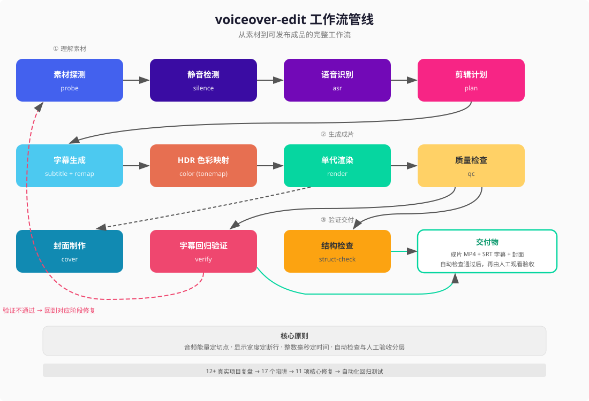

# voiceover-edit

口播视频剪辑管线：从「12 个真实项目的返工记录」中提炼的自动化工具。

Talking-head video editing pipeline, distilled from 12+ real production videos and their rework logs.

## 这个项目是怎么来的

我在做小红书口播视频（竖屏 9:16，一个人对着镜头说话，剪掉停顿、加字幕、出封面）。

前 12 个视频都是半手工流程——用 AI Agent 调 ffmpeg + faster-whisper 一步步跑。每个视频平均返工 2-3 次。返工的原因不是「代码写错了」，而是**同一类问题换了个视频又出现**：字幕和嘴型对不上、画面发白、iPhone 打不开、字幕在奇怪的地方断行……

于是我回过头来，把 12 个项目的所有中间产物、用户反馈、返工记录全部翻出来，逐个定位根因，把修复逻辑固化成代码。

**这个仓库就是那次回溯的产物。**

## 思路：怎么发现问题、怎么修、怎么迭代

### 第一步：从返工记录里挖根因

不是先设计架构再写代码，而是反过来——先收集「哪里出过事」：

1. 翻完 12 个视频项目的会话记录和磁盘产物
2. 提取每次返工的直接原因
3. 按影响面排序（用户能看到的 > 只影响效率的）
4. 归类到管线的具体阶段（切点、字幕、渲染、色彩……）

### 第二步：逐个修复，每个修复都有明确的「为什么」

| 问题 | 怎么改的 | 逻辑 |
|---|---|---|
| 画面死白（42.91% 像素过曝） | 亮度上限从 100 改到 200 | iPhone HLG 格式映射到 SDR 需要更高参考亮度 |
| 字幕丢字 | 落在静音空隙里的词自动吸附到最近片段边缘 | 与其丢掉不如挪到最近的有效位置 |
| 时间戳进位错误（出现 00:00:60） | 整数毫秒再 divmod 拆分 | 整数运算没有浮点精度问题 |
| 中英混排断行怪异 | 用显示宽度代替字符计数 | 中文字=1 宽，英文字母=0.5 宽 |
| 专有名词被拆到两行 | 不可拆分词保护表 | 强制保护 DeepSeek、GitHub 等词的完整性 |
| 新旧数据格式不兼容 | 统一数据结构 + 自动转换旧格式 | 任何版本的中间文件都能被读取 |
| 4K iPhone 视频打不开 | 根据分辨率自动选编码参数 | H.264 标准对不同分辨率有不同的 profile/level 要求 |
| 代码调用了不存在的函数 | 改成调用实际存在的函数 | 模块重构后接口变了但调用方没跟上 |
| 结构检查在自己跟自己比 | 接受两份数据做交叉比较 | 才能发现编辑过程中丢失的内容 |
| ASR 验证缓存不区分参数 | 缓存 key 加入模型路径+提示词+语言 | 换了参数缓存必须自动失效 |
| 模型路径指向已删除的文件 | 4 处旧路径全部更新 | 指向实际存在的模型目录 |

### 第三步：用自动化测试防止回归

关键修复已纳入自动化回归测试。目前测试覆盖：
- SRT 时间戳格式（包括进位边界）
- 中英混排显示宽度计算
- 时间轴重映射（包括空隙吸附）
- 剪辑计划的新旧格式兼容
- HDR 色彩参数生成
- 全部 14 个模块的导入检查
- 9 个 CLI 子命令的分发检查

## 三个核心设计决策

这三个决策是从返工中提炼出来的，每个都对应一个「以前怎么做→出了什么事→现在怎么做」的故事：

### 1. 剪切点由音频能量决定，不用 ASR 时间戳

**以前**：用 faster-whisper 给出的词级时间戳计算切点。
**出了什么事**：ASR 在句首虚词上的时间戳会偏移 0.3-0.5 秒，导致整个词被切掉——成片里没这个音，字幕里却有这两个字。
**现在**：用音频 RMS 能量检测静音区间，切点完全与 ASR 解耦。ASR 只负责「说了什么」，不负责「在哪里切」。

### 2. 断行用显示宽度，不用字符数

**以前**：用 `len()` 计算每行字符数来决定断行。
**出了什么事**：`len("to B")` 返回 4，但这 4 个字符只占两个中文字的宽度。结果英文短词被独占一行，第二行只剩 3-4 个字。
**现在**：自定义 `display_width()` 函数，全角字符算 1.0 宽度，半角算 0.5。

### 3. SRT 时间戳用整数毫秒，不用浮点秒

**以前**：用浮点数表示秒，再格式化成 `HH:MM:SS,mmm`。
**出了什么事**：59.9999... 秒格式化后变成 `00:00:60,000`（不是合法的 SRT 时间）。
**现在**：全程用整数毫秒，divmod 逐级拆分，没有精度问题。

## 工作流管线



主要处理阶段可以单独运行，也可以串成完整管线；色彩转换和时间轴重映射会在管线内自动完成。质检发现的问题可以回到对应阶段修复后重跑，最终再由人工观看验收。

流程图可用 Python 标准库重新生成：`python docs/generate_workflow_diagram.py`。

## 版本迭代过程

| 阶段 | 做了什么 | 数据来源 |
|---|---|---|
| v0: 散装脚本 | 每个视频项目写一套独立脚本 | 12 个项目目录里的 `scripts/` |
| v1: 发现模式 | 翻完 12 个项目的返工记录，发现同一类问题反复出现 | 会话记录 + 用户反馈 |
| v2: 提取共性 | 把 10 个跨项目复用的脚本识别出来，对比差异 | 磁盘产物交叉核对 |
| v3: 统一包 | 合并为 `voiceover_edit` Python 包，统一数据格式 | 代码审查 + schema 设计 |
| v4: 修复 + 测试 | 逐个修复 11 项核心缺陷，每个配测试 | 本文的问题-修复表 |
| v5: 文档 + 陷阱集 | 写下 17 个实战陷阱（`docs/pitfalls.md`） | 全部来自真实事故 |

## 安装

```bash
pip install -e .
# 需要语音识别：
pip install -e ".[asr]"
```

需要：Python >= 3.10，ffmpeg + ffprobe 在 PATH 中。

## 快速上手

```bash
# 检测静音，生成剪切计划
voiceover-edit silence --input video.mov --plan cut_plan.json

# 语音识别（词级时间戳）
voiceover-edit asr --input video.mov --model /path/to/model --words words.json

# 生成字幕
voiceover-edit subtitle --plan cut_plan.json --words words.json --srt subs.srt

# 单代渲染（一条 ffmpeg 命令完成全部处理）
voiceover-edit render --plan edit_plan.json --srt subs.srt --out final.mp4

# 质量检查（timeline 为成片时长，单位秒）
voiceover-edit qc --video final.mp4 --srt subs.srt --timeline 95.2

# 字幕回归验证（重新 ASR 比对）
voiceover-edit verify --video final.mp4 --srt subs.srt --model /path/to/model

# 结构检查（raw-words 为编辑前的 ASR 结果，用于覆盖率对比）
voiceover-edit struct-check --plan cut_plan.json --words words.json --raw-words raw_words.json --video final.mp4

# 探测媒体信息
voiceover-edit probe --input video.mov

# 封面抽帧
voiceover-edit cover --video video.mov --time 30.5 --out cover.jpg
```

## 支持的输入格式

| 属性 | 已测试 | 未测试（欢迎贡献） |
|---|---|---|
| 容器 | MOV, MP4 | MKV, WebM, AVI |
| 视频编码 | H.264, HEVC (8/10-bit) | AV1, VP9 |
| 色彩空间 | SDR (BT.709), HLG (BT.2020) | PQ/HDR10 |
| 画面比例 | 9:16 竖屏 | 16:9, 1:1 |
| 音频 | AAC 立体声/单声道 | Opus, FLAC |
| 帧率 | 24/25/30/60 CFR | VFR |

## 17 个实战陷阱

见 [`docs/pitfalls.md`](docs/pitfalls.md)——全部来自真实视频项目的事故记录，按管线阶段组织。

## 项目结构

```
src/voiceover_edit/
├── probe.py          # ffprobe 封装，HDR 检测
├── silence.py        # 能量法静音检测
├── asr.py            # faster-whisper 词级 ASR
├── plan.py           # 统一剪辑计划 schema
├── subtitle.py       # 字幕生成（dw 断行 + remap）
├── color.py          # HDR→SDR 色彩映射
├── render.py         # 单代 ffmpeg 渲染
├── qc.py             # 媒体质量检查
├── verify.py         # 字幕回归验证
├── struct_check.py   # 结构完整性检查
├── cover.py          # 封面抽帧
└── utils/
    ├── srt.py            # SRT 读写（整数毫秒）
    ├── remap.py          # 时间轴重映射（吸附算法）
    ├── display_width.py  # CJK 显示宽度
    └── resource.py       # 跨平台资源检测
```

## License

MIT
